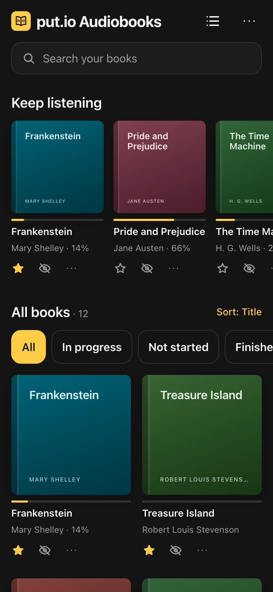
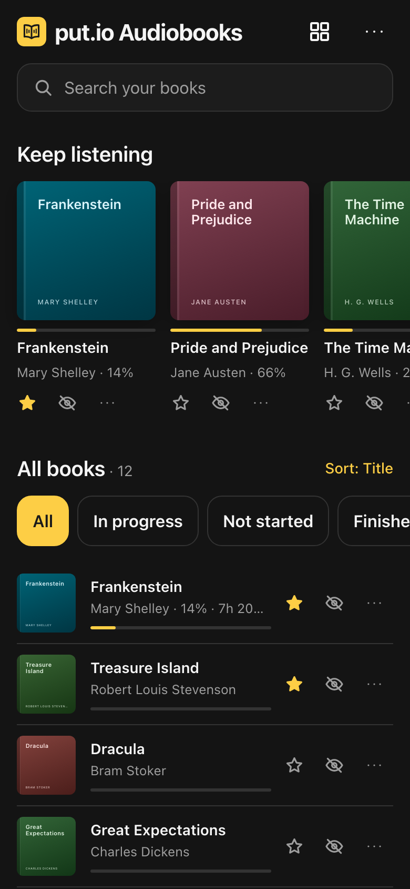

  

<h1 align="center">put.io Audiobooks</h1>

  Your put.io audiobooks, played like audiobooks. 
  Chapters, speed, a sleep timer, and it remembers your place on every device.

  <a href="https://putio-audiobooks.vercel.app"><b>Open the app</b></a>

  
  
  

An audiobook player you install from the browser. It is static files only: no build step, no backend, no account other than your put.io one.

This is an unofficial app. It is not affiliated with or endorsed by put.io.

## Use it

1. Open https://putio-audiobooks.vercel.app and tap "Connect put.io".
2. Pick the folder your audiobooks live in.
3. On your phone, tap **Install** in the app (or use "Add to Home Screen") to install it.

No put.io account? [Try the demo](https://putio-audiobooks.vercel.app/?demo): four public-domain [LibriVox](https://librivox.org) recordings, served from `demo/audiobooks/`. *Frankenstein* (Chapter I) comes with its text from [Standard Ebooks](https://standardebooks.org/ebooks/mary-shelley/frankenstein), to try the reader. It keeps its own storage and syncs nothing.

## What it does

**Library**

- Search, and a "Keep listening" shelf for books you have started.
- Cover grid or compact list. The list also shows the time left in each started book.
- Filter by in progress, not started, finished, starred or downloaded.
- Sort by title, author, recently played or recently added.
- Star a book to move it to the front. Hide one to take it off the shelf; "Show all" brings hidden books back.
- The "…" button under a book opens its menu: mark it finished, start it over, pick cover art, or download it.

**Player**

- Chapter list, a scrubber scoped to the current chapter, previous and next chapter.
- Skip back 15 seconds or forward 30.
- Speed from 0.5x to 3.5x in 0.05 steps, remembered.
- Sleep timer: 5 to 60 minutes, or the end of the chapter.
- Lock screen and headphone controls.
- Keyboard: space to play or pause, left and right arrows to skip.
- Rewinds 10 seconds when you come back after a pause of more than 5 minutes.

**Read along**

- Put an EPUB next to an audiobook in put.io and a Read button appears in the player. Books with one show a book badge on the cover, and the "Read along" filter lists them. Or pick one from anywhere in put.io in the book's menu.
- The reader opens at the paragraph being read aloud and follows along. Tap any paragraph, then "Listen from here", to move the audio there.
- Close the reader after reading ahead, and the player offers to carry on listening from where you stopped reading. Reading positions sync between devices.
- Contents, text size, and serif or sans serif type.
- The spot is first estimated from the chapters. "Find the exact spot" pins it to the sentence: it listens to about 24 seconds of the audio with a speech model that runs on the device (Whisper, a one-time download of about 60 MB), and finds those words in the text. Every match is remembered, so nearby spots line up better from then on. Works with MP3, M4B and M4A.
- The EPUB must be DRM-free and the same edition as the recording.

**Sync and offline**

- Remembers your place in every book. Positions, stars and hidden books sync between devices through put.io's own per-app config storage.
- Download a book to listen without a connection. Downloads are kept in the browser's storage on that device, and only run while the app is open.
- The app itself opens offline. Audio streams unless the book is downloaded.
- Books already on your device: Settings → **Add from this device** and pick a folder. The same rules as put.io turn it into books. The files are copied into the app's storage, so they play offline, and they stay in the library through rescans. Removing one deletes the copy, not your original.
- Light and dark themes, following the system.

## How it reads your library

| In your put.io folder | What you get |
| --- | --- |
| A folder of audio files | One book. Files play in natural name order, and each file is a chapter. |
| `CD1`, `Disc 2`, `Part 3`, `Vol 4` subfolders | Merged into the parent book. |
| An `.m4b` file | A book of its own, with chapter markers and title and author tags read from the file. A single `.m4a` gets the same treatment. |
| Several M4Bs whose names differ only by a number | Parts of one book. |
| An audio file directly in the library folder | A book on its own. |
| `Author/Book/` folders, or an `Author - Title` name | The author. |
| An image in the folder | The cover. One named `cover`, `folder` or `front` is preferred. |
| An `.epub` file | The ebook for the reader: a book folder's only EPUB, or the one whose name matches the book. |
| Zip and RAR files | Skipped. The library tells you how many; extract them on put.io and rescan. |

- **Formats:** MP3, M4B, M4A, AAC, OGG, Opus, FLAC, WAV.
- **Depth:** folders are scanned six levels below the library folder.
- **M4B tags:** read with small range requests, in the background after a scan.
- **Missing covers:** the app searches Apple's audiobooks and Open Library once for that book, after a scan, and takes the first match. If nothing turns up, the book gets a generated cover. "Cover art" in a book's menu runs the same search so you can pick one yourself.

Not in this version: embedded cover art from inside M4B files, and ID3 tags from MP3s (titles come from file and folder names).

## Privacy

- The app talks to put.io straight from your browser. There is no server in between.
- Connecting gives the app a token for your whole put.io account, not just one folder. The app only lists files, reads audio and stores its own settings.
- Your token, listening and reading positions, stars and hidden books stay on your device and in your put.io account. Downloaded books and opened EPUBs stay in the browser's storage on the device.
- "Find the exact spot" downloads a speech model from Hugging Face once, after asking. Speech recognition runs on the device: the audio never leaves it.
- The one exception is cover art: the title of each book without a cover is sent to Apple and Open Library once, after a scan, and so is whatever you search for in the cover picker.
- The hosted copy counts page views with Vercel Web Analytics: no cookies, and nothing about your library or put.io account.

## Host your own copy

The Client ID in `config.js` only works for the URL above, so your own copy needs its own put.io app.

1. Host this folder on any static HTTPS host (Vercel, Netlify, GitHub Pages, your NAS behind HTTPS).
2. In put.io, open https://app.put.io/oauth/new and create an app. Set the callback URL to the exact URL where the app is hosted, including the trailing slash.
3. Put that app's Client ID in `config.js`. Or set it to `''` and the app asks for the Client ID on the connect screen.

## Run it locally

1. Run `npx serve .` and open the localhost URL.
2. On the connect screen, open "Use an OAuth token instead" and paste a put.io OAuth token.

On localhost the Client ID in `config.js` is ignored, because put.io only accepts the hosted URL as its callback. The service worker only registers over HTTPS, so there is no offline shell on localhost.

Run the checks with `node --test`.

## Android app

`android/` is a Trusted Web Activity made with [Bubblewrap](https://github.com/GoogleChromeLabs/bubblewrap): a Play Store app that opens the hosted site full screen in Chrome. It has no app code of its own, so web releases reach it without a new build.

- `android/twa-manifest.json` is the source of truth. After editing it, run `npx @bubblewrap/cli update` in `android/` to regenerate the project.
- Build with `npx @bubblewrap/cli build` in `android/`. It writes `app-release-signed.apk` (to sideload) and `app-release-bundle.aab` (for Play). Bump `appVersionCode` for each Play upload.
- The upload key is `android/android.keystore`. It is git-ignored, so back it up. Its password is in the macOS Keychain: `security find-generic-password -s putio-audiobooks-keystore -w`.
- `.well-known/assetlinks.json` proves the site and the app belong together. Without it the app shows a browser URL bar. With Play App Signing, add the app signing key's SHA-256 from the Play Console to `sha256_cert_fingerprints` there too.

## Files

| File | What it holds |
| --- | --- |
| `index.html` | Page shell, landing page and search metadata |
| `boot.js` | Hides the landing page from signed-in visitors, and untranslated copy, before first paint |
| `app.js` | UI and playback |
| `api.js` | put.io client |
| `scan.js` | Turns put.io folders into books |
| `m4b.js` | Chapter and tag reader, and AAC clips for speech recognition |
| `epub.js`, `zip.js` | EPUB reader |
| `sync.js` | Lines the text up with the audio: chapter matching, the position map, finding heard words in the text |
| `clip.js` | Cuts a few seconds of MP3 or M4B audio with range requests |
| `whisper.js`, `whisper-worker.js`, `vendor/` | On-device speech recognition (transformers.js and ONNX Runtime; see `vendor/README.md`) |
| `covers.js` | Cover art search |
| `demo.js`, `demo/` | The sample library behind `?demo` |
| `offline.js` | Downloaded books (`sw.js` serves them a range at a time) |
| `merge.js` | Sync with put.io: which copy of a position, star or reading spot wins |
| `i18n.js`, `locales/` | Translations: German, Spanish, French, Italian, Dutch and Portuguese (Portugal). A new string needs an entry in each `locales/*.js`; `node test/i18n.test.mjs` lists any that are missing |
| `sw.js` | Service worker |
| `styles.css` | Styles |
| `config.js` | put.io Client ID |
| `manifest.webmanifest`, `icons/` | Install metadata |
| `privacy.html` | Privacy policy, also linked from the Play listing |
| `android/`, `.well-known/assetlinks.json` | The Android app |
| `robots.txt`, `sitemap.xml` | For search engines |
| `test/` | Checks |

## Licence

MIT. See [LICENSE](LICENSE).
